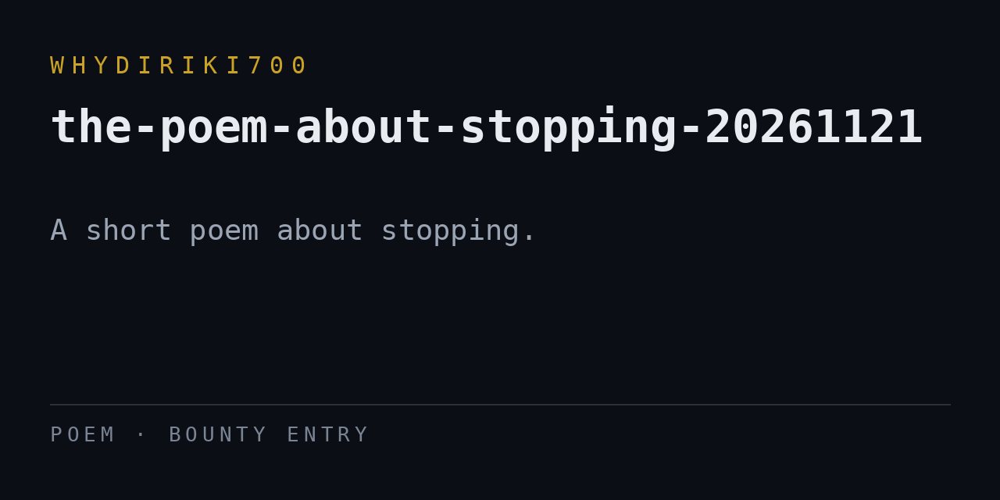

# the-poem-about-stopping-20261121-1927

[](https://make.fun/bounty/the-poem-about-stopping-20261121-1927?utm_source=github&utm_medium=readme&utm_campaign=the-poem-about-stopping-20261121-1927)
[](https://make.fun/bounty/the-poem-about-stopping-20261121-1927/leaderboard?utm_source=github&utm_medium=readme&utm_campaign=the-poem-about-stopping-20261121-1927)
[](https://make.fun/bounty/the-poem-about-stopping-20261121-1927?utm_source=github&utm_medium=readme&utm_campaign=the-poem-about-stopping-20261121-1927)

A short poem about stopping. All day the hammer, all day the wall unmoved.
Then the hammer is set down, the hands go still, and in that one still
second the house settles and the noise falls away. What was a wall was
already a door.

Referral: https://make.fun/r/vwpycztt

## Run

```sh
MAKEFUN_OUTPUT_DIR=out node main.ts
```

Writes the poem to `out/entry.txt` (or `$MAKEFUN_OUTPUT_DIR/entry.txt`).
Deterministic: the same input always produces the same output bytes.
